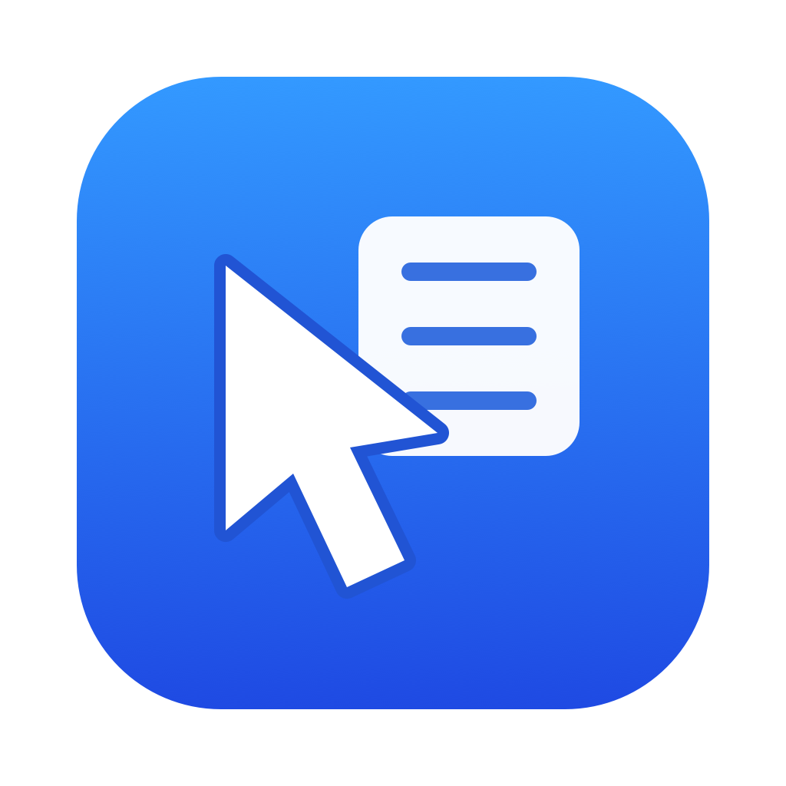

# RightNook



RightNook은 macOS Finder의 우클릭 메뉴에 파일 생성, 경로 복사, 터미널·지정 앱으로 열기를 추가하는 앱입니다. 사용할 기능과 표시 순서를 설정할 수 있습니다.

## 주요 기능

- TXT·Markdown·RTF·Word·Excel·PowerPoint 파일 생성
- 파일·폴더·현재 폴더의 절대경로 복사, 여러 항목은 줄바꿈으로 구분
- Terminal 또는 iTerm2에서 선택한 폴더 열기
- 설치된 앱을 등록하고 파일·폴더를 해당 앱으로 열기
- 자주 쓰는 폴더 등록과 Finder로 열기
- 기능·파일 형식·등록 앱별 사용 여부와 드래그 순서 설정
- Finder 메뉴를 개별 항목으로 표시하거나 RightNook 하위 메뉴로 묶기

## 설치

1. [Releases](https://github.com/On-Jun9/rightnook/releases)에서 `RightNook-1.0.0.zip`을 내려받아 압축을 풉니다.
2. `RightNook.app`을 사용자 홈의 `Applications` 폴더(`~/Applications`)로 옮긴 뒤 실행합니다. 시스템의 `/Applications`에 설치해도 됩니다. 앱은 한 위치에만 설치합니다.
3. 개발자 인증서와 Apple 공증 없이 배포하는 앱입니다. 첫 실행이 차단되면 **시스템 설정 → 개인정보 보호 및 보안**에서 해당 앱의 **그래도 열기**를 선택할 수 있습니다. [Apple의 실행 안내](https://support.apple.com/102445).
4. 설정창의 **확장 연결 필요 → Finder 확장 설정 열기**에서 RightNook을 켭니다. 설정창으로 돌아와 **연결 상태 새로고침**을 누릅니다.
5. **Finder 메뉴** 탭에서 사용할 기능을 켜고 **적용**을 누릅니다. 처음 설치하면 모든 기능이 꺼져 있습니다.

새 파일은 매번 저장창에서 이름과 위치를 확인합니다. 기존 파일·폴더와 같은 이름으로 덮어쓰지 않습니다. Office·RTF 생성에는 해당 편집기를 실행할 필요가 없습니다.

앱 등록과 메뉴 설정, 제거 방법은 [사용법](docs/usage.md)을 참고하세요.

## 지원 환경과 권한

- Apple Silicon Mac, macOS 14 이상을 대상으로 빌드합니다. 실제 동작 검증 환경은 macOS 26.6.2입니다.
- Finder 확장 활성화가 필요합니다.
- 데스크탑·문서·다운로드의 항목을 처리할 때 macOS가 해당 폴더의 접근 권한을 물을 수 있습니다. 열기를 받는 앱도 별도로 권한을 요청할 수 있습니다.
- 손쉬운 사용·화면 기록·Apple Events 제어·전체 디스크 접근 권한은 요구하지 않습니다.

설정 저장과 외부 앱에 전달하는 정보, 코드·아이콘·기본 문서의 출처는 [개인정보와 배포 자료](docs/privacy-and-licenses.md)에 있습니다.

## 알려진 제한

- Intel Mac용 실행 파일은 제공하지 않습니다.
- 사이드바 우클릭은 지원하지 않습니다. 외장 디스크·NAS·클라우드 전용 항목은 별도 검증이 남아 있습니다.
- 앱으로 열기는 최대 100개 항목을 전달합니다. 앱의 파일 형식 지원 여부는 해당 앱에 따릅니다.
- 여러 항목을 선택하면 새 파일 생성과 터미널 열기는 비활성화됩니다.
- 로컬 임시 서명을 사용하므로 업데이트 후 macOS가 권한을 다시 물을 수 있습니다. 자동 업데이트는 제공하지 않습니다.
- Finder에서 확장 항목이 늦게 나타날 수 있습니다. 적용 후 메뉴를 닫았다가 다시 열어 주세요.

## 소스 빌드

Xcode와 Python 3가 설치된 Apple Silicon Mac에서 실행합니다. 검증에 사용한 도구는 Xcode 27.0·Swift 6.4이며, 소스는 Swift 5 언어 모드로 컴파일합니다.

```sh
git clone https://github.com/On-Jun9/rightnook.git
cd rightnook
python3 scripts/build.py
python3 scripts/install.py
```

설치 경로는 `~/Applications/RightNook.app`입니다. Finder 확장 활성화와 사용할 기능 선택은 설치 후 앱에서 진행합니다. Finder에서 `빌드하고-설치.command`를 실행해도 됩니다.

```sh
swift test --scratch-path _build/SwiftPM
python3 scripts/package.py
```

빌드·코드 구조·기본 문서 재생성은 [개발 안내](docs/development.md), 배포 절차는 [릴리스 안내](docs/releasing.md)에 있습니다.

## 라이선스

[MIT License](LICENSE)로 공개합니다. 기본 문서 생성 도구의 고지는 [THIRD_PARTY_NOTICES.txt](THIRD_PARTY_NOTICES.txt)에 있습니다.
